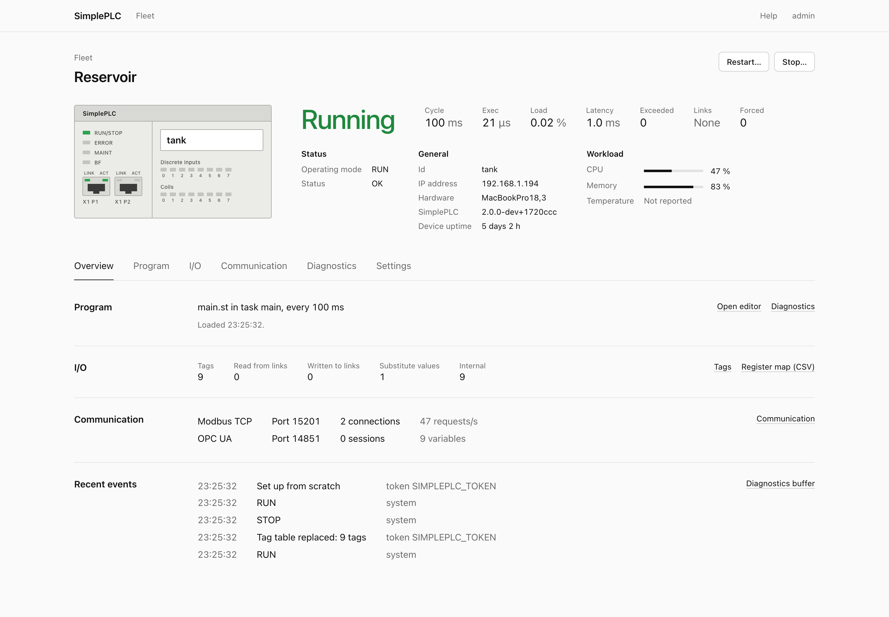
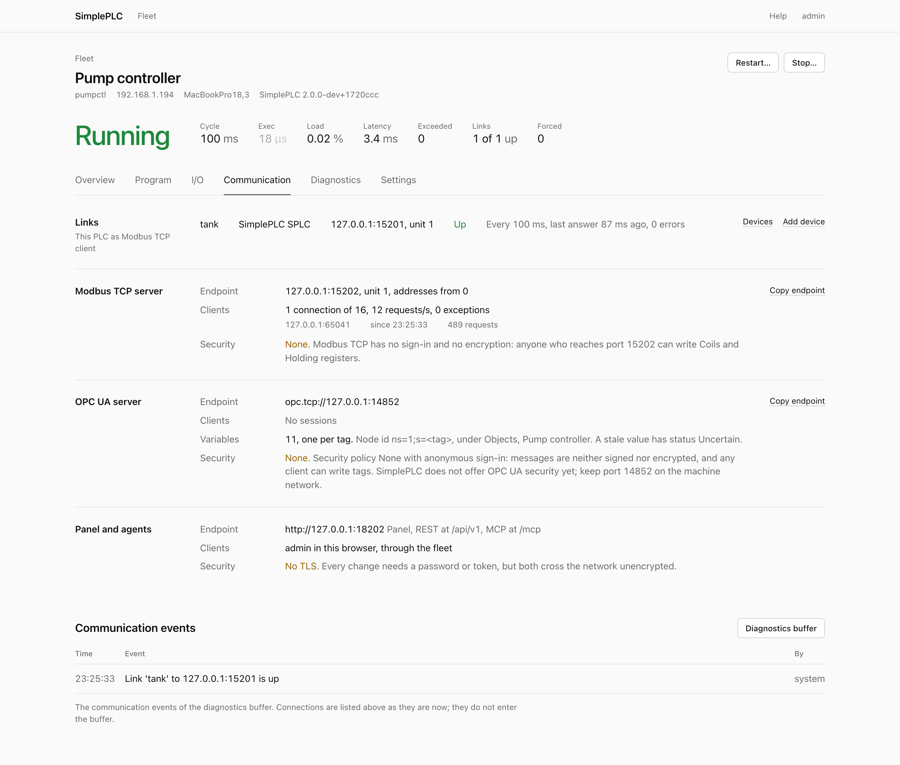
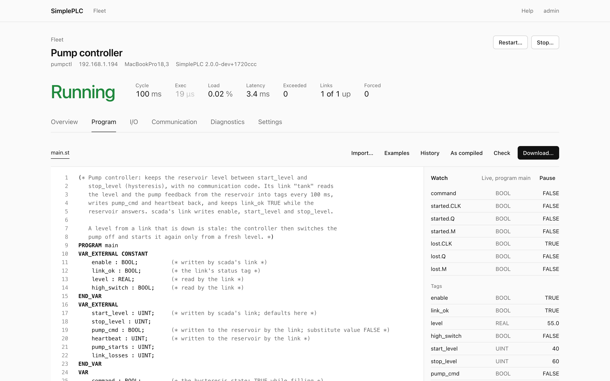
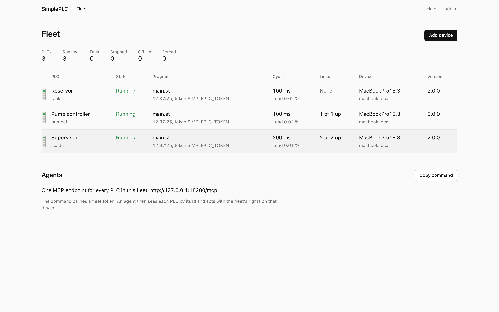
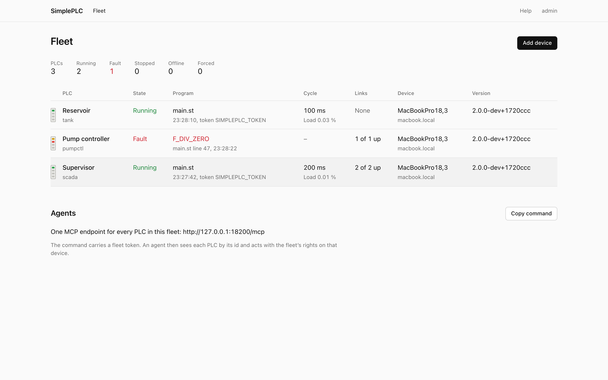

<h1 align="center">SimplePLC</h1>

<p align="center">
  <b>A soft PLC in one small executable.</b><br>
  IEC 61131-3 Structured Text · Modbus TCP · OPC UA · web panel · REST API · MCP for AI agents
</p>

<p align="center">
  <a href="https://github.com/tommy-berg/SimplePLC/actions/workflows/ci.yml"></a>
  <a href="https://hub.docker.com/r/tommyhbe/simpleplc"></a>
  <a href="https://hub.docker.com/r/tommyhbe/simpleplc"></a>
  <a href="LICENSE"></a>
</p>

<p align="center">
  
</p>

Each copy of SimplePLC is **one PLC**: on a Raspberry Pi next to a machine, on a Linux PC or in a
container. Programs are Structured Text, compiled and checked before they run. The process image is
served as Modbus TCP and OPC UA, with a web panel, a REST API and an MCP server for agents. Several
PLCs talk Modbus TCP to each other, and a **fleet** gives one panel and one agent endpoint for all of them.

- **A strict, auditable compiler.** No silent narrowing, diagnostics that say how to fix the problem, and the program *as compiled* on request
- **Deterministic.** Verified bytecode with no allocation, and the same bits on every platform (SimplePLC has its own maths functions)
- **Online change.** Saving a program replaces the running one between two cycles and keeps the values of its variables
- **Safe on failure.** Run-time errors stop the PLC in FAULT with the line, and outputs get their substitute values
- **Made for agents.** Every operation is an MCP tool: setting up a PLC, tags, programs, forcing, logs
- **Small.** One static Linux binary for x86-64, ARM64 and 32-bit Raspberry Pi OS, and a 13 MB container image

---

## 🚀 Start

### Docker

The image is on Docker Hub: [tommyhbe/simpleplc](https://hub.docker.com/r/tommyhbe/simpleplc)
(linux/amd64, linux/arm64 and linux/arm/v7, so it also runs on Docker Desktop for macOS and Windows).

```
docker pull tommyhbe/simpleplc
docker run -p 8080:8080 -p 502:502 -p 4840:4840 -v plc1:/data tommyhbe/simpleplc
```

The setup code is in the container's log (`docker logs <container>`).

### Linux and Raspberry Pi

Download the file for your machine from the
[latest release](https://github.com/tommy-berg/SimplePLC/releases/latest) (x86-64, ARM64, or
ARMv7 for 32-bit Raspberry Pi OS), make it executable and run it:

```
chmod +x simpleplc-linux-arm64 && mv simpleplc-linux-arm64 simpleplc
./simpleplc
```

```
SimplePLC 2.0.0
  Data       /home/pi/simpleplc-data
  Web panel  http://192.168.1.20:8080   (on this computer: http://localhost:8080)
  Setup code 3f1c9a2e-77b04d10   (enter it in the web panel to create your account)
  PLC        raspberrypi  Modbus :502  OPC UA :4840  [RUN]
Ready. Press Ctrl+C to stop.
```

Open the web panel, enter the setup code and choose a password. The PLC is named after the
computer and starts empty. From there you can write a program in the editor, connect a Modbus device
under **I/O**, or start from an example on the Overview (tank level control, traffic light, remote
I/O between two PLCs, ...).

`sudo simpleplc install-service` makes it a system service. It then starts at every boot with nobody
logged in, may use port 502, and keeps its data in `/var/lib/simpleplc`. Without sudo it starts at login.

## 🔌 Connect

Tags name addresses in the four Modbus areas (coils, discrete inputs, holding and input registers)
and give each one a type: bool, int16, uint16, int32, uint32 or float32. 32-bit values take two
registers, high word first. Outputs can have a **substitute value**, which is written at STOP and FAULT.

| Client | How |
|--------|-----|
| **Modbus TCP** (HMIs, Factory I/O, pymodbus, QModMaster) | port 502, any unit id, addresses from 0; functions 1–6, 15, 16, 17, 22, 23 and 43/14 |
| **OPC UA** (UaExpert, Ignition, Node-RED) | `opc.tcp://<host>:4840`, security policy None; each tag is the variable `ns=1;s=<tag name>`; at most 100 sessions, each ending at the latest a minute after its last request |
| **Scripts** | create a token under *Users and tokens*, then `curl -H "Authorization: Bearer <token>" http://localhost:8080/api/v1/plcs` |
| **AI agents (MCP)** | `claude mcp add --transport http simpleplc http://localhost:8080/mcp --header "Authorization: Bearer <token>"` |

<p align="center">
  
</p>

Point an agent at a device to work on its PLC, or at a fleet to work on all of them (the tools then
take the PLC's id). Every PLC operation of the REST API is an MCP tool: setting a PLC up, tags,
checking and deploying programs with every diagnostic, program variables, forcing, events, logs,
device information, and Modbus reads and writes of any device. There are also prompts for writing a
program and for building a network.

An agent can also start its own PLC, with no SimplePLC running:
`claude mcp add simpleplc -- simpleplc mcp --data ./lab`. That PLC starts blank. Its Modbus and
OPC UA listen on 127.0.0.1 only (`--listen` changes it), and it has no web panel unless you ask for
one (`--web`, or `--port N`). [docs/api.md](docs/api.md) describes the REST API, the fleet and the MCP server.

Ports below 1024 need extra rights. When port 502 cannot be used, SimplePLC takes the next free port
from 5020 (OPC UA: from 4841) and says so. To use 502, run
`sudo setcap cap_net_bind_service=+ep ./simpleplc` once. Containers can use 502 as is.

## 📝 Programs

```st
(* Start the pump at or below start_level, stop it at stop_level. The level
   comes from another PLC through a link, which also sets tank_ok. *)
PROGRAM main
VAR_EXTERNAL CONSTANT
    level : REAL;          (* read by the link *)
    tank_ok : BOOL;        (* the link's status tag *)
    start_level : UINT;
    stop_level : UINT;
END_VAR
VAR_EXTERNAL
    pump_cmd : BOOL;       (* sent to the pump by the link; substitute value FALSE *)
END_VAR
    IF NOT tank_ok THEN
        pump_cmd := FALSE;             (* no level, no pump *)
    ELSIF level <= start_level THEN
        pump_cmd := TRUE;
    ELSIF level >= stop_level THEN
        pump_cmd := FALSE;
    END_IF;
END_PROGRAM
```

A program declares the tags it uses in `VAR_EXTERNAL` (`CONSTANT` for the ones it only reads)
and keeps its state in `VAR`. The standard timers, edge detectors, counters and functions are all
available.

- **Strict compiler.** No silent narrowing (`INT := DINT` needs a conversion), no `a < b < c`, and
  every diagnostic says how to fix the problem. `simpleplc check main.st --tags tags.json --listing`
  prints the problems and the program *as compiled*, with every conversion and parenthesis written out.
- **Runs as verified bytecode** with no allocation. A run-time error (overflow, division by zero,
  an index out of range) stops the PLC in FAULT with the line, and tags with a substitute value get it.
- **Online change.** Saving a changed program replaces the running one between two cycles and
  keeps the values of the variables that still exist. A program that doesn't compile is refused,
  and the running one carries on.
- **Same results everywhere.** A program gives the same bits on every platform, because the maths
  functions are SimplePLC's own.

The reference is the panel's Help page and [docs/structured-text.md](docs/structured-text.md).
[docs/st-compliance.md](docs/st-compliance.md) states what is implemented and how.

<p align="center">
  
</p>

## 🏭 A network of PLCs

Several PLCs are several SimplePLCs: processes, containers or Raspberry Pis that talk Modbus TCP.
A **link** in a PLC's configuration makes it a Modbus TCP client of another device. The link says
which of its tags to read from which addresses, which to write, how often, and which status tag is
TRUE while the device answers. Programs only use tags, and every PLC is a Modbus TCP server to whoever
polls it.

Two PLCs and a fleet on one Docker network (on Raspberry Pis, give `--device` their addresses instead):

```
export SIMPLEPLC_TOKEN=$(openssl rand -hex 16)
docker network create plant
docker run -d --name tank --hostname tank --network plant -e SIMPLEPLC_TOKEN \
    -e SIMPLEPLC_EXAMPLE=tank tommyhbe/simpleplc
docker run -d --name alarms --hostname alarms --network plant -e SIMPLEPLC_TOKEN \
    -e SIMPLEPLC_EXAMPLE=remote-io tommyhbe/simpleplc
docker run -d --name fleet --network plant -p 127.0.0.1:8080:8080 -e SIMPLEPLC_TOKEN \
    -e SIMPLEPLC_DEVICES=tank,alarms tommyhbe/simpleplc fleet
```

`alarms` runs the remote-io example. Its link reads `tank`'s level every 200 ms, and its program
raises an alarm above a limit. The **fleet** shows the PLCs of many devices on one panel, with their
links, and gives agents one MCP endpoint for all of them. It can also start without devices and adopt
them with a pairing code ([docs/api.md](docs/api.md), "The fleet").

<table>
  <tr>
    <td></td>
    <td></td>
  </tr>
  <tr>
    <td align="center"><sub>Three PLCs in one fleet</sub></td>
    <td align="center"><sub>A fault shows where it happened</sub></td>
  </tr>
</table>

## ⚙️ Settings

Everything lives in one data directory: `./simpleplc-data`, or `~/.simpleplc` when the current
directory is not writable, and `/data` in the container. One process uses it at a time.

```
config.json          web port, log level and the PLC: id, name, tags, tasks, links, ports
users.json           users and API tokens (hashed)
programs/<name>.st   programs and libraries (1 MB each, 2 MB together); .history/ keeps earlier versions,
                     .deployed/ the files each program last loaded with (what a restart runs, never a draft)
mode                 run or stop, as last commanded on the panel or the API: the PLC powers up in it
```

The panel edits all of it.

- **Tasks and links:** a PLC has up to 8 tasks (`cycle_ms` 1–60000) and 16 links. `realtime` gives
  tasks with a `priority` real-time scheduling (SCHED_FIFO).
- **Retentive memory:** tags with `"retain": true` and `RETAIN` variables are written to
  `retain.json` when they change, at most once a second, and come back after a power cut. Every
  other tag starts at 0, and every other variable starts from its initial value.
- **Mode:** the commanded mode is kept too, so a PLC in STOP comes back in STOP.

A new data directory starts from these flags or environment variables. An existing one keeps its
configuration and says so.

| Flag | Environment | Default |
|------|-------------|---------|
| `--id` | `SIMPLEPLC_ID` | the host name (a container's `hostname`) |
| `--name` | `SIMPLEPLC_NAME` | the example's title, or the id |
| `--example` | `SIMPLEPLC_EXAMPLE` | `none`: a blank PLC; or `tank`, `blink`, `traffic-light`, `remote-io`, `factory-io-conveyor`, `temperature-pid` |
| `--modbus-port`, `--opcua-port` | `SIMPLEPLC_MODBUS_PORT`, `SIMPLEPLC_OPCUA_PORT` | 502, 4840 |
| `--listen` | | every interface (`simpleplc mcp`: 127.0.0.1); on the first run it applies to Modbus and OPC UA too |

```
simpleplc [--data DIR] [--port N] [--listen ADDR] [-v | -q] [--log-json]
simpleplc fleet --device URL ...             one panel and MCP endpoint for the PLCs of many devices
simpleplc mcp [--data DIR] [--web]           MCP on stdin/stdout with its own PLC
simpleplc mcp --url URL --token TOKEN        MCP on stdin/stdout for a running SimplePLC or fleet
simpleplc check FILE.st ... [--tags FILE] [--listing]    compile and print every problem
simpleplc install-service                    run at login; with sudo: a system service at boot
simpleplc --version | --help
```

`--data` and `--port` also come from `SIMPLEPLC_DATA` and `SIMPLEPLC_WEB_PORT`. `SIMPLEPLC_TOKEN`
is an administrator token for scripts, agents and fleets, and is never stored. A fleet signs in to
its `--device` devices with `SIMPLEPLC_DEVICE_TOKEN` (default: its own `SIMPLEPLC_TOKEN`).

## 🔒 Security

> [!WARNING]
> Modbus TCP has no authentication, and OPC UA runs with security policy None (no encryption, no
> signing). Anyone who can reach those ports can read and write the PLC.

- **Network:** keep PLCs on a network you trust, or set their `listen` addresses to `127.0.0.1` in
  Settings. The network example above publishes only the fleet's panel, on `127.0.0.1`.
- **Panel and API:** they need a login or a token, but are served over plain HTTP.
- **Programs:** they have no file, process or network access. They read and write their tags, and
  the bytecode is verified before it runs.
- **Fleet:** a fleet holds an administrator token for every device, so treat it like the
  engineering station it is.
- **Components:** releases after 2.0.0 include an SBOM (CycloneDX) for each binary and for the image,
  naming every component built in with its exact version, the linked C and C++ runtime included.
  Every week CI checks them for known vulnerabilities ([`security/`](security/)).
- **Verify a download:** `gh attestation verify simpleplc-linux-arm64 --repo tommy-berg/SimplePLC`
  shows that GitHub Actions built it from this repository; add
  `--predicate-type https://cyclonedx.org/bom` to check its SBOM. For the image:
  `gh attestation verify oci://tommyhbe/simpleplc:<version> --repo tommy-berg/SimplePLC`.
- **Found a vulnerability?** Report it privately, as [SECURITY.md](SECURITY.md) describes.

## 🛠️ Build from source

You need a C++23 compiler (GCC 13 or later, or Clang 19 or later) and CMake 3.24.
`cmake -B build && cmake --build build -j` builds `./build/simpleplc`.

- **open62541:** an installed open62541 1.4+ is used when found. Otherwise (or with
  `-DSIMPLEPLC_FETCH_OPEN62541=ON`), open62541 1.5.9 is built from source, which needs Python 3 and Git.
- **Static builds:** `-DSIMPLEPLC_STATIC=ON` links statically (with musl, as the releases do). The
  Dockerfile builds the same static binary for any platform Docker can build for.

## License

MIT, see [LICENSE](LICENSE). Bundled components and their licences are listed in [THIRD_PARTY_LICENSES.md](THIRD_PARTY_LICENSES.md).
