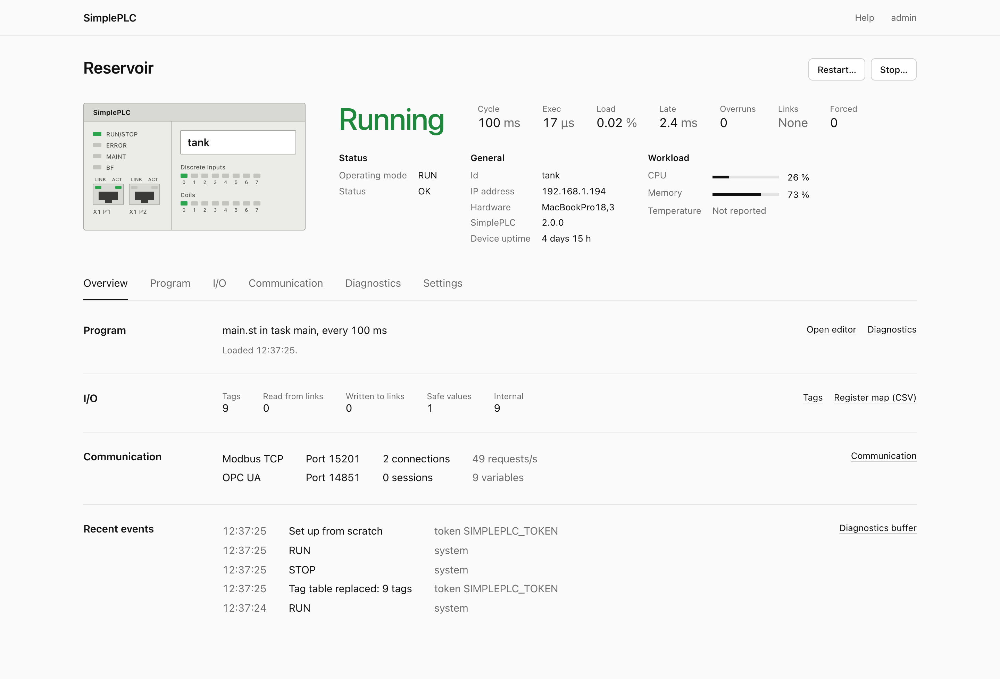

# SimplePLC

[](https://github.com/tommy-berg/SimplePLC/actions/workflows/ci.yml)

SimplePLC is a soft PLC in one small executable: each copy is one PLC, on a Raspberry Pi next
to a machine, in a container or on a laptop. Programs are IEC 61131-3 Structured Text, compiled
and checked before they run; the process image is served as Modbus TCP and OPC UA, with a web
panel, a REST API and an MCP server for agents. Several PLCs talk Modbus TCP to each other, and
a fleet gives one panel and one agent endpoint for all of them.



## Start

Download the file for your system from the
[latest release](https://github.com/tommy-berg/SimplePLC/releases/latest)
(Linux x86-64 and ARM, including 32-bit Raspberry Pi OS; macOS; Windows) and run it:

```
./simpleplc
```

```
SimplePLC 2.0.0
  Data       /home/pi/simpleplc-data
  Web panel  http://192.168.1.20:8080   (on this computer: http://localhost:8080)
  Setup code 3f1c9a2e-77b04d10   (enter it in the web panel to create your account)
  PLC        raspberrypi  Modbus :502  OPC UA :4840  [RUN]
Ready. Press Ctrl+C to stop.
```

Open the web panel, enter the setup code and choose a password. The PLC is named after the
computer and starts empty: write a program in the editor, connect a Modbus device under I/O,
or start from an example on the Overview (a tank level control, a traffic light, remote I/O
between two PLCs, ...). `sudo simpleplc install-service` makes it a system service on Linux: it
starts at every boot with nobody logged in, may use port 502, and keeps its data in
`/var/lib/simpleplc`. Without sudo (and on macOS) it starts at login.

With Docker (amd64, arm64, arm/v7); the setup code is in the container's log:

```
docker run -p 8080:8080 -p 502:502 -p 4840:4840 -v plc1:/data ghcr.io/tommy-berg/simpleplc
```

## Connect

Tags name addresses in the four Modbus areas (coils, discrete inputs, holding and input
registers) with a type (bool, int16, uint16, int32, uint32, float32; 32-bit values take two
registers, high word first) and, for outputs, a substitute value that is written at STOP and FAULT.

| Client | How |
|--------|-----|
| Modbus TCP (HMIs, Factory I/O, pymodbus, QModMaster) | port 502, any unit id, addresses from 0; functions 1–6, 15, 16, 17, 22, 23 and 43/14 |
| OPC UA (UaExpert, Ignition, Node-RED) | `opc.tcp://<host>:4840`, security policy None; each tag is the variable `ns=1;s=<tag name>`; at most 100 sessions, each ending at the latest a minute after its last request |
| Scripts | create a token under *Users and tokens*, then `curl -H "Authorization: Bearer <token>" http://localhost:8080/api/v1/plcs` |
| AI agents (MCP) | `claude mcp add --transport http simpleplc http://localhost:8080/mcp --header "Authorization: Bearer <token>"` |

Point an agent at a device for its PLC, or at a fleet for all of them (the tools then take the
PLC's id). Every PLC operation of the REST API is an MCP tool: setting a PLC up, tags, checking
and deploying programs with every diagnostic, tags and program variables, forcing, events, logs,
device information, Modbus reads and writes of any device, and prompts for writing a program and
building a network. Without a running SimplePLC an agent can start its own: `claude mcp add
simpleplc -- simpleplc mcp --data ./lab`; that PLC starts blank, its Modbus and OPC UA listen on
127.0.0.1 only (`--listen` changes it), and it has no web panel unless asked for (`--web`, or
`--port N`). The REST API, the fleet and the MCP server are described in [docs/api.md](docs/api.md).

Ports below 1024 need extra rights on Linux and macOS. When port 502 cannot be used, SimplePLC
takes the next free port from 5020 (OPC UA: from 4841) and says so; to use 502 on Linux, run
`sudo setcap cap_net_bind_service=+ep ./simpleplc` once. Containers may use 502 as is.

## Programs

```st
(* Start the pump at or below start_level, stop it at stop_level. The level
   comes from another PLC through a link, which also sets tank_ok. *)
PROGRAM main
VAR_EXTERNAL CONSTANT
    level : REAL;          (* read by the link *)
    tank_ok : BOOL;        (* the link's status tag *)
    start_level : UINT;
    stop_level : UINT;
END_VAR
VAR_EXTERNAL
    pump_cmd : BOOL;       (* sent to the pump by the link; substitute value FALSE *)
END_VAR
    IF NOT tank_ok THEN
        pump_cmd := FALSE;             (* no level, no pump *)
    ELSIF level <= start_level THEN
        pump_cmd := TRUE;
    ELSIF level >= stop_level THEN
        pump_cmd := FALSE;
    END_IF;
END_PROGRAM
```

A program declares the tags it uses in `VAR_EXTERNAL` (`CONSTANT` for the ones it only reads)
and keeps its state in `VAR`; the standard timers, edge detectors, counters and functions are
there. The compiler is strict: no silent narrowing (`INT := DINT` needs a conversion), no
`a < b < c`, and every diagnostic says how to fix it. `simpleplc check main.st --tags tags.json
--listing` prints the problems and the program *as compiled*, every conversion and parenthesis
written out. Programs run as verified bytecode without allocation; a run-time error (overflow,
division by zero, an index out of range) stops the PLC in FAULT with the line, and tags with a
substitute value get it. Saving a changed program replaces the running one between two cycles and
keeps the values of the variables that still exist; one that does not compile is refused and
the running one carries on. The same program gives the same bits on every platform: the maths
functions are SimplePLC's own. The reference is the panel's Help page and
[docs/structured-text.md](docs/structured-text.md); [docs/st-compliance.md](docs/st-compliance.md)
states what is implemented and how.

## A network of PLCs

Several PLCs are several SimplePLCs: processes, containers or Raspberry Pis that talk Modbus
TCP. A **link** in a PLC's configuration makes it a Modbus TCP client of another device: which
of its tags to read from which addresses, which to write, a period, and a status tag that is
TRUE while the device answers. Programs only use tags; every PLC is a Modbus TCP server to
whoever polls it. Two PLCs and a fleet on one Docker network (on Raspberry Pis, give
`--device` their addresses instead):

```
export SIMPLEPLC_TOKEN=$(openssl rand -hex 16)
docker network create plant
docker run -d --name tank --hostname tank --network plant -e SIMPLEPLC_TOKEN \
    -e SIMPLEPLC_EXAMPLE=tank ghcr.io/tommy-berg/simpleplc
docker run -d --name alarms --hostname alarms --network plant -e SIMPLEPLC_TOKEN \
    -e SIMPLEPLC_EXAMPLE=remote-io ghcr.io/tommy-berg/simpleplc
docker run -d --name fleet --network plant -p 127.0.0.1:8080:8080 -e SIMPLEPLC_TOKEN \
    -e SIMPLEPLC_DEVICES=tank,alarms ghcr.io/tommy-berg/simpleplc fleet
```

`alarms` runs the remote-io example: its link reads `tank`'s level every 200 ms and its
program raises an alarm above a limit. The **fleet** shows the PLCs of many devices on one
panel, with their links, and gives agents one MCP endpoint for all of them; it can also start
without devices and adopt them with a pairing code ([docs/api.md](docs/api.md), "The fleet").


## Settings

Everything lives in one data directory (`./simpleplc-data`, or `~/.simpleplc` when the
current directory is not writable; `/data` in the container). One process uses it at a time.

```
config.json          web port, log level and the PLC: id, name, tags, tasks, links, ports
users.json           users and API tokens (hashed)
programs/<name>.st   programs and libraries (1 MB each, 2 MB together); .history/ keeps earlier versions,
                     .deployed/ the files each program last loaded with (what a restart runs, never a draft)
mode                 run or stop, as last commanded on the panel or the API: the PLC powers up in it
```

The panel edits all of it. A PLC has up to 8 tasks (`cycle_ms` 1–60000) and 16 links; `realtime`
gives tasks with a `priority` real-time scheduling (SCHED_FIFO on Linux, time-constraint on
macOS). Retentive memory: tags with `"retain": true` and `RETAIN` variables are written to
`retain.json` when they change, at most once a second, and come back after a power cut; every other
tag starts at 0 and every other variable from its initial value. The commanded mode is kept too, so
a PLC in STOP comes back in STOP. A new data directory starts from these flags or variables; an existing one
keeps its configuration and says so:

| Flag | Environment | Default |
|------|-------------|---------|
| `--id` | `SIMPLEPLC_ID` | the host name (a container's `hostname`) |
| `--name` | `SIMPLEPLC_NAME` | the example's title, or the id |
| `--example` | `SIMPLEPLC_EXAMPLE` | `none`: a blank PLC; or `tank`, `blink`, `traffic-light`, `remote-io`, `factory-io-conveyor` |
| `--modbus-port`, `--opcua-port` | `SIMPLEPLC_MODBUS_PORT`, `SIMPLEPLC_OPCUA_PORT` | 502, 4840 |
| `--listen` | | every interface (`simpleplc mcp`: 127.0.0.1); on the first run it applies to Modbus and OPC UA too |

```
simpleplc [--data DIR] [--port N] [--listen ADDR] [-v | -q] [--log-json]
simpleplc fleet --device URL ...             one panel and MCP endpoint for the PLCs of many devices
simpleplc mcp [--data DIR] [--web]           MCP on stdin/stdout with its own PLC
simpleplc mcp --url URL --token TOKEN        MCP on stdin/stdout for a running SimplePLC or fleet
simpleplc check FILE.st ... [--tags FILE] [--listing]    compile and print every problem
simpleplc install-service                    run at login; with sudo on Linux: a system service at boot
simpleplc --version | --help
```

`--data` and `--port` also come from `SIMPLEPLC_DATA` and `SIMPLEPLC_WEB_PORT`. `SIMPLEPLC_TOKEN`
is an administrator token for scripts, agents and fleets, never stored; a fleet signs in to its
`--device` devices with `SIMPLEPLC_DEVICE_TOKEN` (default: its own `SIMPLEPLC_TOKEN`).

## Security

The panel and the API need a login or a token, but are served over plain HTTP. Modbus TCP has
no authentication and OPC UA runs with security policy None (no encryption, no signing): anyone
who can reach those ports can read and write the PLC. Keep PLCs on a network you trust, or set
their `listen` addresses to `127.0.0.1` in Settings; the network above publishes only the
fleet's panel, on `127.0.0.1`. Programs have no file, process or network access: they read and
write their tags, and the bytecode is verified before it runs. A fleet holds an administrator
token for every device: treat it like the engineering station it is.

## Build from source

Needs a C++23 compiler (GCC 13, Clang 17, MSVC 2022) and CMake 3.24; `cmake -B build && cmake --build build -j`
builds `./build/simpleplc`. An installed open62541 1.4+ is used when found; otherwise (or with
`-DSIMPLEPLC_FETCH_OPEN62541=ON`) open62541 1.5.9 is built from source, which needs Python 3
and Git. `-DSIMPLEPLC_STATIC=ON` links statically (Linux with musl, Windows). The Dockerfile
builds the same static binary for any platform Docker can build for.

## License

MIT, see [LICENSE](LICENSE); bundled components and their licences: [THIRD_PARTY_LICENSES.md](THIRD_PARTY_LICENSES.md).
