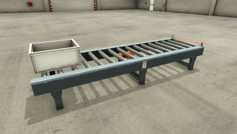

# Factory I/O: conveyor (From A to B)

The program runs the conveyor until a box reaches the sensor at its end. Factory I/O
is the Modbus TCP client: it writes its sensor to coil 0 (`box_at_end`) and reads the
conveyor motor from discrete input 0 (`conveyor`, substitute value FALSE).

1. In SimplePLC, start the PLC from the **Factory I/O: conveyor** example: on an empty
   PLC, choose it under *Start from an example* on the Overview; on a PLC that already
   has a program, use Settings → *Start over*.
2. Read the PLC's Modbus TCP address and port on the Overview under *Reach this PLC*
   (also on the Communication page).
3. In Factory I/O, open the scene *From A to B* and choose the driver
   **Modbus TCP/IP Client**. Enter the address and port from step 2, unit id 1.
4. Map the sensor *At exit* to coil 0 and the conveyor motor to discrete input 0.
5. Press Run in Factory I/O. The I/O page of the panel shows both tags change as the
   box moves.
